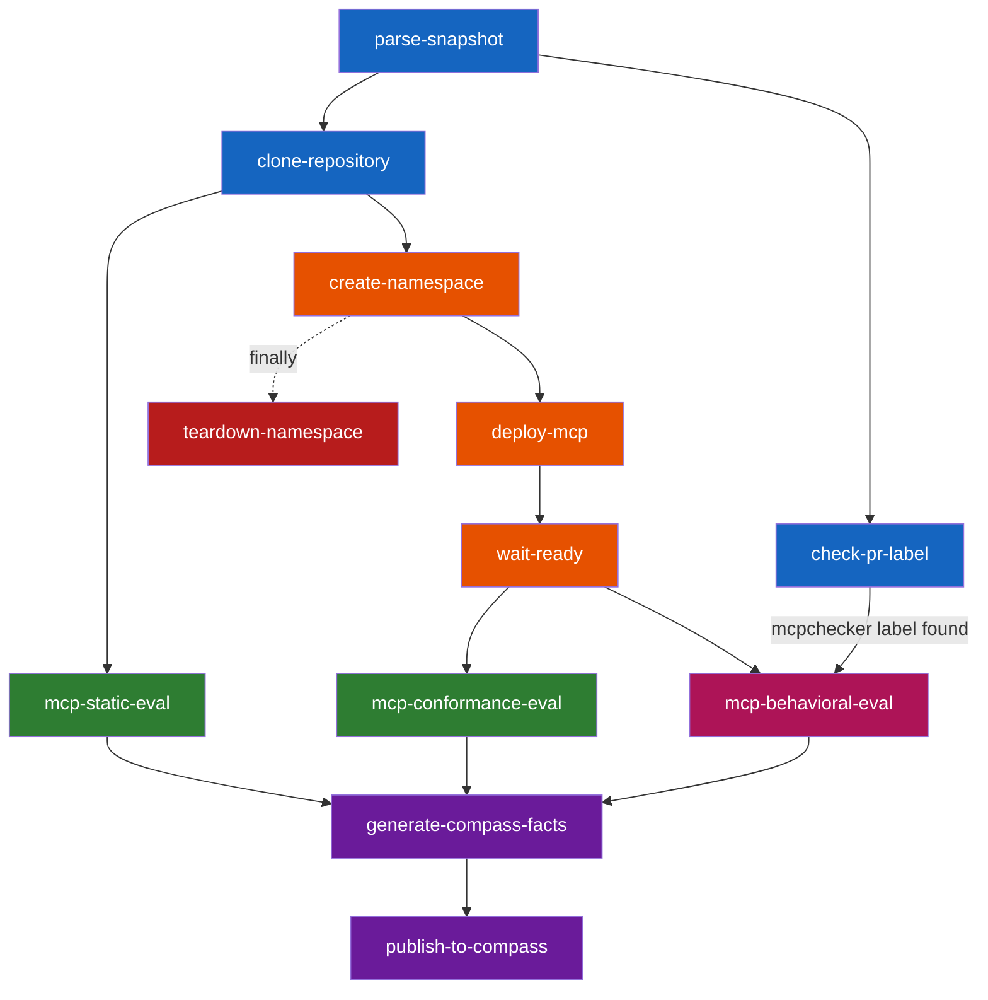

# MCP server evaluation pipeline

This document describes the MCP (Model Context Protocol) server evaluation
pipeline -- a Tekton-based CI pipeline that automatically evaluates MCP
servers for security, protocol conformance, and behavioral correctness as
part of a Konflux build pipeline. The pipeline deploys the server under test into an
ephemeral namespace on a remote cluster, runs three evaluation tiers against
it, and publishes results to Compass SoundCheck.

## Evaluation tiers

The pipeline evaluates MCP servers across three tiers, each progressively
deeper:

| Tier | Task | Requires deployment | Uses LLM | What it checks |
|------|------|---------------------|----------|----------------|
| Static | `mcp-static-eval` | No | No | Secrets management (gitleaks), no user-code execution (semgrep), license compliance (licensee) |
| Conformance | `mcp-conformance-eval` | Yes | No | HTTP transport, MCP protocol compliance, schema conformance, tool annotations, rate limiting, timeouts, OpenAPI conformance |
| Behavioral | `mcp-behavioral-eval` | Yes | Yes | Tool correctness, edge-case handling, sensitive data redaction |

Static evaluation runs against the source code only. Conformance and
behavioral evaluation require a live MCP server deployed via Helm.

## Pipeline tasks

### parse-snapshot

Parses a Konflux Snapshot JSON to extract the component image reference,
git URL, revision, and component name. This bridges the Konflux Snapshot
model with the parameter-based tasks downstream.

### create-namespace

Creates an ephemeral namespace `mcp-eval-<run-id>` on the remote target
cluster and grants the pipeline ServiceAccount access via a RoleBinding.
Cleaned up by `teardown-namespace` in the pipeline's `finally` block.

### deploy-mcp

Deploys the MCP server into the ephemeral namespace using its Helm chart.
Copies image pull and credential Secrets from the pipeline namespace to
the ephemeral namespace before deployment. Expects the MCP server source
repo to be pre-cloned into the workspace (via a `git-clone` task).

### wait-ready

Waits for all Deployments and StatefulSets in the ephemeral namespace to
complete rollout. Verifies every pod reaches Ready state. Fails if no
workloads appear, rollout times out, or pods are in error state.

### mcp-static-eval

Runs three static checks against the MCP server source (no deployment
needed): secrets management via gitleaks, no user-code execution via
semgrep, and license compliance via licensee. Produces pass/fail results.

### mcp-conformance-eval

Black-box deterministic conformance probe against the deployed MCP server.
No LLM. Probes the server over Streamable HTTP for protocol, schema, and
HTTP conformance using a three-state model (pass/fail/not_evaluated). Runs
as a Kubernetes Job on the target cluster.

### check-pr-label

Checks whether the pull request or merge request associated with the
current commit carries a specific label. Supports GitHub, GitHub
Enterprise, and GitLab. Used to gate the LLM-driven behavioral
evaluation behind a `mcpchecker` label so it only runs when explicitly
opted in.

### mcp-behavioral-eval

LLM-driven behavioral evaluation using mcpchecker against the deployed
MCP server. Runs as a Kubernetes Job on the target cluster. Tests tool
correctness, edge-case handling, and sensitive data redaction using
configurable task suites. Pass threshold is 70%. Only runs when the
`check-pr-label` task confirms the `mcpchecker` label is present on the
pull request.

### generate-compass-facts

Generates Compass SoundCheck check-level fact payload files from the
evaluation phase summaries. Each fact file contains data for a single
check result. Does not contact Compass -- only prepares the payloads.

### publish-to-compass

Publishes the generated fact payloads to Compass SoundCheck. Creates a
temporary ConfigMap on the target cluster to mount fact files into its
publishing Job. Defaults to dry-run mode (`dry-run: "true"`).

### teardown-namespace

Deletes the ephemeral evaluation namespace in the pipeline's `finally`
block. Safety check: only deletes namespaces matching the `mcp-eval-*`
prefix. Gracefully handles non-existent namespaces.

## Pipeline flow



**Legend:**
- Blue -- input parsing and source fetch (clone-repository is your existing pipeline task)
- Orange -- environment setup (namespace, deployment, readiness)
- Green -- non-LLM evaluation (static + conformance)
- Pink -- LLM-driven evaluation (behavioral)
- Purple -- results publishing (Compass SoundCheck)
- Red -- cleanup (always runs)

`mcp-static-eval` runs in parallel with the deploy/wait-ready chain
because it only needs source code, not a running server. The conformance
and behavioral evaluations both depend on `wait-ready` and can run in
parallel with each other.

## Usage: adding MCP evaluation to an existing build pipeline

The snippet assumes your pipeline already has a `clone-repository` task
that clones the MCP server source into the shared workspace (see
[Prerequisites](#prerequisites)).

### Workspaces

Add the `target-kubeconfig` workspace declaration under
`pipelineSpec.workspaces`:

```yaml
- name: target-kubeconfig
  description: >-
    Kubeconfig Secret for the target test cluster. Mounted read-only
    into tasks that interact with the remote cluster.
```

And add the workspace binding under `spec.workspaces`:

```yaml
- name: target-kubeconfig
  secret:
    secretName: mcp-eval-target-kubeconfig
```

### Tasks

Add the following under your PipelineRun's `pipelineSpec.tasks`:

```yaml
# --- Input parsing ---
- name: parse-snapshot
  taskRef:
    resolver: bundles
    params:
      - name: name
        value: parse-snapshot
      - name: bundle
        value: quay.io/ecosystem-appeng/konflux-skill-evaluation/parse-snapshot:0.1.0
      - name: kind
        value: task
  params:
    - name: SNAPSHOT
      value: $(params.SNAPSHOT)

# --- Label gate for behavioral evaluation ---
- name: check-pr-label
  runAfter: [parse-snapshot]
  taskRef:
    resolver: bundles
    params:
      - name: name
        value: check-pr-label
      - name: bundle
        value: quay.io/ecosystem-appeng/konflux-skill-evaluation/check-pr-label:0.1.0
      - name: kind
        value: task
  params:
    - name: git-url
      value: $(tasks.parse-snapshot.results.git-url)
    - name: git-revision
      value: $(tasks.parse-snapshot.results.git-revision)
    - name: target-label
      value: mcpchecker

# --- Environment setup ---
- name: create-namespace
  runAfter: [clone-repository]
  taskRef:
    resolver: bundles
    params:
      - name: name
        value: create-namespace
      - name: bundle
        value: quay.io/ecosystem-appeng/konflux-skill-evaluation/create-namespace:0.1.0
      - name: kind
        value: task
  params:
    - name: pipeline-run-id
      value: $(context.pipelineRun.name)
  workspaces:
    - name: target-kubeconfig
      workspace: target-kubeconfig

- name: deploy-mcp
  runAfter: [create-namespace]
  taskRef:
    resolver: bundles
    params:
      - name: name
        value: deploy-mcp
      - name: bundle
        value: quay.io/ecosystem-appeng/konflux-skill-evaluation/deploy-mcp:0.1.0
      - name: kind
        value: task
  params:
    - name: namespace-name
      value: $(tasks.create-namespace.results.namespace-name)
    - name: component-image
      value: $(tasks.parse-snapshot.results.component-image)
  workspaces:
    - name: source
      workspace: shared-workspace
    - name: target-kubeconfig
      workspace: target-kubeconfig

- name: wait-ready
  runAfter: [deploy-mcp]
  taskRef:
    resolver: bundles
    params:
      - name: name
        value: wait-ready
      - name: bundle
        value: quay.io/ecosystem-appeng/konflux-skill-evaluation/wait-ready:0.1.0
      - name: kind
        value: task
  params:
    - name: namespace-name
      value: $(tasks.create-namespace.results.namespace-name)
  workspaces:
    - name: target-kubeconfig
      workspace: target-kubeconfig

# --- Evaluation ---
- name: mcp-static-eval
  runAfter: [clone-repository]
  taskRef:
    resolver: bundles
    params:
      - name: name
        value: mcp-static-eval
      - name: bundle
        value: quay.io/ecosystem-appeng/konflux-skill-evaluation/mcp-static-eval:0.1.0
      - name: kind
        value: task
  workspaces:
    - name: source
      workspace: shared-workspace

- name: mcp-conformance-eval
  runAfter: [wait-ready]
  taskRef:
    resolver: bundles
    params:
      - name: name
        value: mcp-conformance-eval
      - name: bundle
        value: quay.io/ecosystem-appeng/konflux-skill-evaluation/mcp-conformance-eval:0.1.0
      - name: kind
        value: task
  params:
    - name: namespace-name
      value: $(tasks.create-namespace.results.namespace-name)
  workspaces:
    - name: source
      workspace: shared-workspace
    - name: target-kubeconfig
      workspace: target-kubeconfig

- name: mcp-behavioral-eval
  runAfter: [wait-ready, check-pr-label]
  when:
    - input: $(tasks.check-pr-label.results.has-label)
      operator: in
      values: ["true"]
  taskRef:
    resolver: bundles
    params:
      - name: name
        value: mcp-behavioral-eval
      - name: bundle
        value: quay.io/ecosystem-appeng/konflux-skill-evaluation/mcp-behavioral-eval:0.1.0
      - name: kind
        value: task
  params:
    - name: namespace-name
      value: $(tasks.create-namespace.results.namespace-name)
    - name: pipeline-run-id
      value: $(context.pipelineRun.name)
    - name: submission-name
      value: $(tasks.parse-snapshot.results.component-name)
  workspaces:
    - name: source
      workspace: shared-workspace
    - name: target-kubeconfig
      workspace: target-kubeconfig

# --- Results publishing ---
- name: generate-compass-facts
  runAfter: [mcp-static-eval, mcp-conformance-eval, mcp-behavioral-eval]
  taskRef:
    resolver: bundles
    params:
      - name: name
        value: generate-compass-facts
      - name: bundle
        value: quay.io/ecosystem-appeng/konflux-skill-evaluation/generate-compass-facts:0.1.0
      - name: kind
        value: task
  params:
    - name: component-name
      value: $(tasks.parse-snapshot.results.component-name)
  workspaces:
    - name: source
      workspace: shared-workspace

- name: publish-to-compass
  runAfter: [generate-compass-facts]
  taskRef:
    resolver: bundles
    params:
      - name: name
        value: publish-to-compass
      - name: bundle
        value: quay.io/ecosystem-appeng/konflux-skill-evaluation/publish-to-compass:0.1.0
      - name: kind
        value: task
  params:
    - name: namespace-name
      value: $(tasks.create-namespace.results.namespace-name)
    - name: dry-run
      value: "false"
  workspaces:
    - name: source
      workspace: shared-workspace
    - name: target-kubeconfig
      workspace: target-kubeconfig
```

### Finally block

Add the following under your PipelineRun's `pipelineSpec.finally`:

```yaml
- name: teardown-namespace
  taskRef:
    resolver: bundles
    params:
      - name: name
        value: teardown-namespace
      - name: bundle
        value: quay.io/ecosystem-appeng/konflux-skill-evaluation/teardown-namespace:0.1.0
      - name: kind
        value: task
  params:
    - name: namespace-name
      value: $(tasks.create-namespace.results.namespace-name)
  workspaces:
    - name: target-kubeconfig
      workspace: target-kubeconfig
```

## Prerequisites

### Existing pipeline requirements

Your Konflux build pipeline must already include a `clone-repository`
task that clones the MCP server source into the shared workspace. This
is standard Konflux build-pipeline plumbing and is not provided by this
task catalog.

### MCP server repository requirements

The MCP server repository must include:

- **Helm chart** at `chart/` (configurable via the `helm-chart-path`
  parameter on the `deploy-mcp` task).
- **Test values** at `values-test.yaml` (configurable via the
  `values-test-path` parameter on the `deploy-mcp` task). These values
  configure the server for evaluation (ports, resource limits, test
  credentials, etc.).
- The Helm chart's values must include `image.repository` and `image.ref`
  keys so the pipeline can inject the built container image. If your chart
  uses different keys, set the `image-helm-key` and `image-ref-helm-key`
  parameters on the `deploy-mcp` task to match.

### Secrets on the Konflux pipeline cluster

These Secrets must exist in the **Konflux namespace** where the
PipelineRun executes:

**Target cluster kubeconfig** -- The kubeconfig file will be provided by
the maintenance team during onboarding. Store it as a Secret:

```bash
kubectl create secret generic mcp-eval-target-kubeconfig \
  --namespace=<konflux-pipeline-namespace> \
  --from-file=kubeconfig=<path-to-kubeconfig>
```

**Image pull credentials** -- Registry credentials needed to pull the
MCP server container image. Must be stored as Secret `image-pull-secret`
with key `.dockerconfigjson`.

If the MCP server needs additional credentials at runtime (e.g., backend
API keys), list their Secret names in the `credentials-secrets` parameter
on `deploy-mcp`.

## Maintainers: target test cluster setup

This section describes the one-time cluster setup required on the target
test cluster before the MCP evaluation pipeline can run.

### ServiceAccount

Create the pipeline ServiceAccount in the `default` namespace:

```yaml
apiVersion: v1
kind: ServiceAccount
metadata:
  name: mcp-eval-pipeline-sa
  namespace: default
  labels:
    app.kubernetes.io/name: mcp-eval
```

### RBAC: namespace management

The pipeline creates and deletes ephemeral `mcp-eval-*` namespaces. This
requires a ClusterRole and ClusterRoleBinding:

```yaml
apiVersion: rbac.authorization.k8s.io/v1
kind: ClusterRole
metadata:
  name: mcp-eval-namespace-manager-cr
  labels:
    app.kubernetes.io/name: mcp-eval
rules:
- apiGroups: ["", "project.openshift.io"]
  resources: [projects, namespaces]
  verbs: [get, list, create, delete]
- apiGroups: [rbac.authorization.k8s.io]
  resources: [rolebindings]
  verbs: [get, create, delete]
- apiGroups: [rbac.authorization.k8s.io]
  resourceNames: [mcp-eval-ephemeral-access-cr]
  resources: [clusterroles]
  verbs: [bind]
---
apiVersion: rbac.authorization.k8s.io/v1
kind: ClusterRoleBinding
metadata:
  name: mcp-eval-namespace-manager-cr-binding
  labels:
    app.kubernetes.io/name: mcp-eval
roleRef:
  apiGroup: rbac.authorization.k8s.io
  kind: ClusterRole
  name: mcp-eval-namespace-manager-cr
subjects:
- kind: ServiceAccount
  name: mcp-eval-pipeline-sa
  namespace: default
```

### RBAC: ephemeral namespace access

The pipeline needs full control within each ephemeral namespace to deploy
the MCP server, run evaluation Jobs, and manage supporting resources:

```yaml
apiVersion: rbac.authorization.k8s.io/v1
kind: ClusterRole
metadata:
  name: mcp-eval-ephemeral-access-cr
  labels:
    app.kubernetes.io/name: mcp-eval
rules:
- apiGroups: [""]
  resources: [pods, services, configmaps, serviceaccounts, persistentvolumeclaims]
  verbs: [get, list, create, update, patch, delete]
- apiGroups: [""]
  resources: [secrets]
  verbs: [get, list, create, update, patch, delete]
- apiGroups: [apps]
  resources: [deployments, statefulsets, replicasets]
  verbs: [get, list, create, update, patch, delete]
- apiGroups: [batch]
  resources: [jobs]
  verbs: [get, list, create, delete]
- apiGroups: [networking.k8s.io]
  resources: [networkpolicies]
  verbs: [get, list, create, update, patch, delete]
- apiGroups: [""]
  resources: [resourcequotas, limitranges]
  verbs: [get, list, create, update, patch, delete]
- apiGroups: [""]
  resources: [pods/log, events]
  verbs: [get, list]
- apiGroups: [""]
  resources: [pods/exec]
  verbs: [create]
```

This ClusterRole is bound per-namespace by the `create-namespace` task
via a RoleBinding in each ephemeral namespace.

### RBAC: secret access

The pipeline ServiceAccount needs read access to the LLM and Compass
Secrets in the `default` namespace:

```yaml
apiVersion: rbac.authorization.k8s.io/v1
kind: Role
metadata:
  name: mcp-eval-secret-role
  namespace: default
  labels:
    app.kubernetes.io/name: mcp-eval
rules:
- apiGroups: [""]
  resourceNames:
  - mcp-eval-llm-agent
  - mcp-eval-llm-judge
  - mcp-eval-compass
  - mcp-eval-ca
  resources: [secrets]
  verbs: [get]
---
apiVersion: rbac.authorization.k8s.io/v1
kind: RoleBinding
metadata:
  name: mcp-eval-secret-role-binding
  namespace: default
  labels:
    app.kubernetes.io/name: mcp-eval
roleRef:
  apiGroup: rbac.authorization.k8s.io
  kind: Role
  name: mcp-eval-secret-role
subjects:
- kind: ServiceAccount
  name: mcp-eval-pipeline-sa
  namespace: default
```

### Secrets

Create the following Secrets in the `default` namespace (configurable via
`secrets-namespace`) on the target test cluster:

| Secret | Keys | Purpose |
|--------|------|---------|
| `mcp-eval-llm-agent` | `openai-api-key`, `openai-base-url`, `model-name` | LLM agent credentials for mcpchecker (behavioral eval) |
| `mcp-eval-llm-judge` | `openai-api-key`, `openai-base-url`, `model-name` | Judge LLM model configuration (behavioral eval) |
| `mcp-eval-ca` | `ca.crt` | CA certificate bundle for internal LLM endpoints (if using self-signed certs) |
| `mcp-eval-compass` | `api-key`, `compass-url`, `entity-ref` | Compass SoundCheck credentials for publishing results |

The `model-name` field uses the format `provider:model-path` (e.g.,
`openai:Qwen/Qwen3.5-35B-A3B`). Both agent and judge Secrets support
OpenAI-compatible and Anthropic endpoints.

Use the templates below, replacing placeholder values:

```bash
# LLM agent credentials
kubectl create secret generic mcp-eval-llm-agent \
  --namespace=default \
  --from-literal=openai-api-key='<your-api-key>' \
  --from-literal=openai-base-url='<your-openai-compatible-endpoint>/v1' \
  --from-literal=anthropic-api-key='' \
  --from-literal=anthropic-base-url='' \
  --from-literal=model-name='openai:<your-model-name>'

# LLM judge credentials
kubectl create secret generic mcp-eval-llm-judge \
  --namespace=default \
  --from-literal=openai-api-key='<your-api-key>' \
  --from-literal=openai-base-url='<your-openai-compatible-endpoint>/v1' \
  --from-literal=anthropic-api-key='' \
  --from-literal=anthropic-base-url='' \
  --from-literal=model-name='openai:<your-judge-model-name>'

# CA certificate (if using self-signed certs for LLM endpoints)
kubectl create secret generic mcp-eval-ca \
  --namespace=default \
  --from-file=ca.crt=<path-to-ca-certificate>

# Compass SoundCheck credentials
kubectl create secret generic mcp-eval-compass \
  --namespace=default \
  --from-literal=api-key='<your-compass-api-key>' \
  --from-literal=compass-url='<your-compass-soundcheck-url>' \
  --from-literal=entity-ref='<your-entity-ref>'
```

### Kubeconfig

Generate a kubeconfig for the `mcp-eval-pipeline-sa` ServiceAccount and
provide it to pipeline users during onboarding. The kubeconfig must
authenticate as the `mcp-eval-pipeline-sa` ServiceAccount (or another
identity with the same RBAC grants) on the target cluster.

### Summary of cluster resources

| Resource | Kind | Namespace | Purpose |
|----------|------|-----------|---------|
| `mcp-eval-pipeline-sa` | ServiceAccount | `default` | Identity used by the pipeline to authenticate against the target cluster |
| `mcp-eval-namespace-manager-cr` | ClusterRole | cluster-scoped | Allows creating and deleting ephemeral `mcp-eval-*` namespaces and managing RoleBindings within them |
| `mcp-eval-namespace-manager-cr-binding` | ClusterRoleBinding | cluster-scoped | Grants the `mcp-eval-pipeline-sa` ServiceAccount namespace management permissions |
| `mcp-eval-ephemeral-access-cr` | ClusterRole | cluster-scoped | Grants full control over workloads, secrets, jobs, and networking within ephemeral evaluation namespaces |
| `mcp-eval-secret-role` | Role | `default` | Allows reading the LLM and Compass Secrets required by the evaluation tasks |
| `mcp-eval-secret-role-binding` | RoleBinding | `default` | Grants the `mcp-eval-pipeline-sa` ServiceAccount read access to evaluation Secrets |
| `mcp-eval-llm-agent` | Secret | `default` | API key, endpoint URL, and model name for the LLM agent used in behavioral evaluation |
| `mcp-eval-llm-judge` | Secret | `default` | API key, endpoint URL, and model name for the LLM judge used to score behavioral evaluation results |
| `mcp-eval-ca` | Secret | `default` | CA certificate bundle for TLS verification of internal LLM and Compass endpoints |
| `mcp-eval-compass` | Secret | `default` | API key, Compass URL, and entity reference for publishing evaluation results to Compass SoundCheck |
