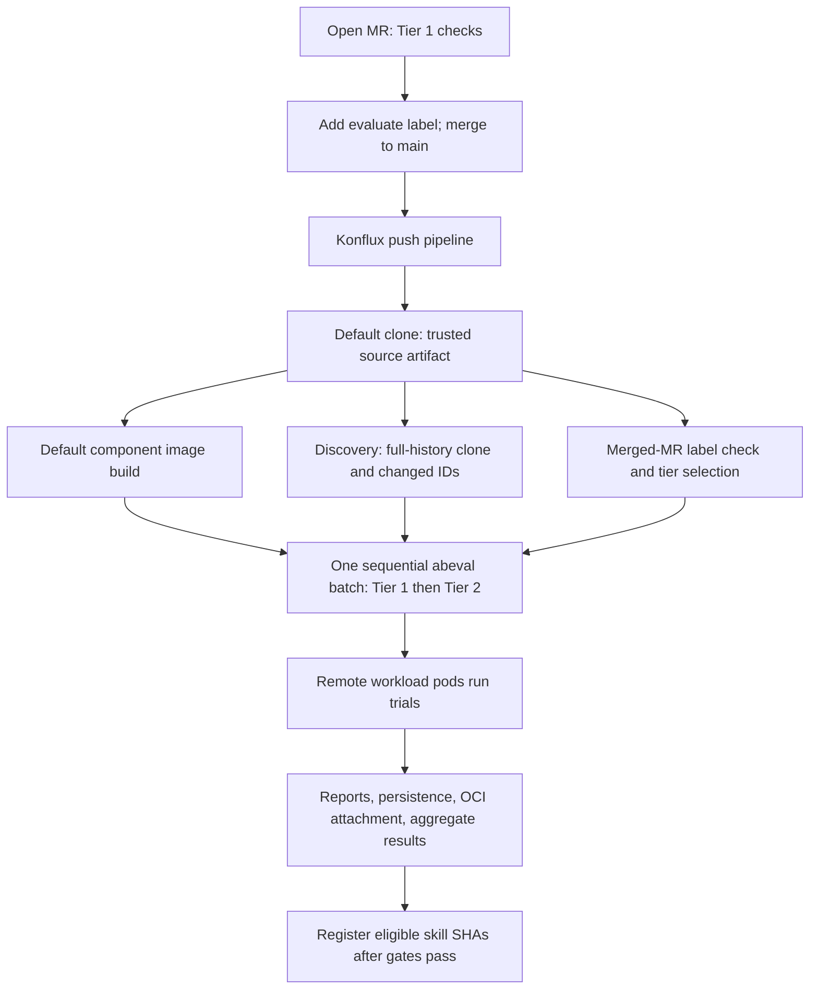

# Add skill evaluation to a Konflux build pipeline

This guide takes a GitLab plugin repository from a working, generated Konflux
build pipeline to evaluating changed skills with the shared tasks in this
repository. It covers repository inputs, task bundles, cluster resources, and
the first successful run. Examples use `team/plugins`, a Konflux tenant namespace
of your choice, and a workload namespace named `plugin-evaluation`.

**Label timing:** the current `check-pr-label` task checks **merged GitLab merge
requests**. Add `evaluate` before merging the MR. The push to `main` then runs
Tier 1 and Tier 2. Adding the label to an open MR does not, by itself, start
Tier 2. Here, “PR” refers to a GitLab MR. GitHub needs different label/discovery/
registration integration; the evaluation task itself can be reused there.

Tier 1 validates skill structure and runs deterministic security and quality
scans. Tier 2 validates/reviews the submission and runs agent trials and judges
through AEH/Harbor. The runner image includes the `skill-scanner` and
`harness-eval` scanners as well as the evaluation CLI.

## 1. Understand what comes from where

| Element | Provided by | Your responsibility |
|---|---|---|
| Default build, trusted source artifact, component image, build service account, Git authentication workspace | Your generated Konflux `.tekton` build pipelines | Keep the working build configuration and extend it. |
| `check-pr-label:0.1.0` | This repository, published as a Tekton bundle | Set your GitLab server, URL-encoded project path, label, and token Secret. |
| `discover-changed-skills:0.1.0` | This repository, published as a Tekton bundle | Supply your repository URL, detection script, catalog, and read credentials. |
| Tier selection (`auto` → `1` or `1,2`) | An inline task in the consuming pipeline | Copy the selector from the companion example; it is not another shared bundle. |
| `aeh-skill-eval:2.1.4` | This repository, published as a Tekton bundle | Supply skill IDs, trusted source, revision, endpoints, credentials, and evidence workspace. |
| `abeval` CLI and complete upstream AEH runtime | [agentic_eval_flow](https://github.com/RHEcosystemAppEng/agentic_eval_flow), packaged in the runner image | Consume the runner image; no evaluator checkout or installation in your build is needed. |
| Trial runtime | The separate `agent-eval-harness` trial image | Ensure the workload cluster can pull it. This is different from your built plugin image. |
| Skill content, submissions, cases, judges, MCP schemas/fixtures | Your plugin repository | Commit these alongside the skills. |
| `update-registered-shas:1.0.0` | This repository, published as a Tekton bundle | Supply a compatible registration script and a bot allowed to push to your target branch. |
| Model gateway, workload Kubernetes/OpenShift cluster, PostgreSQL, S3/MinIO, optional Compass | Your team or the evaluation platform team | Obtain endpoints, namespace access, credentials, and network connectivity. Shared tasks do not provision these services. |

The [agentic-plugins pipelines](https://gitlab.cee.redhat.com/ai5-marketplace/agentic-plugins/-/tree/dc7ac5acbb8837ef052aed09ea8995978b027daa/.tekton)
are the reference consumer. This guide and the
[companion pipeline fragment](examples/evaluation-extension.yaml) reflect their
checked-in bundle/runtime pins as of 2026-11-01. Confirm that your Konflux
installation can resolve those bundles before your first run; a checked-in pin
alone does not verify registry availability.



Without the label, `tiers=auto` selects Tier 1 only. A direct push with no merged
MR also selects Tier 1. Explicit `tiers=1`, `2`, or `1,2` overrides label selection;
keep `auto` for the label-driven push workflow. The shared evaluation task accepts
only `1`, `2`, or `1,2`; the pipeline selector resolves `auto` first.

## 2. Prepare the plugin repository

The batch task uses identifiers such as `my-plugin/my-skill`, with this layout:

```text
catalog-info.yaml                         # root catalog Location
my-plugin/
  catalog-info.yaml                       # Location linking skill manifests
  skills/my-skill/
    SKILL.md
    catalog-info.yaml                     # registered source SHA
submissions/my-plugin/
  my-skill/
    metadata.yaml
    eval-control.yaml                     # pairwise control
    eval-treatment.yaml                   # pairwise treatment
    cases/case-001/
      input.yaml
      annotations.yaml                    # when required by your judges
      mock-mcps/my-server/fixture.json     # when the case uses MCP
  mcp-servers/my-server/schema.json        # plugin-shared mock MCP schema
scripts/
  catalog_tree.py
  detect_changed_skills.py
  update_skill_shas.py
  register_evaluation_results.py
```

For single-arm evaluation, use `aeh_mode: single` and `eval.yaml` instead of the
pairwise control/treatment files. See the
[runtime documentation](https://github.com/RHEcosystemAppEng/agentic_eval_flow/blob/53496ad4aaad6203b6bf44f81e6a112d4844feaa/README.md)
and a complete
[reference submission](https://gitlab.cee.redhat.com/ai5-marketplace/agentic-plugins/-/tree/dc7ac5acbb8837ef052aed09ea8995978b027daa/submissions/rh-sre/system-context).
Adapt prompts, expected outputs, judges, model names, and plugin paths for your
skill. Trial execution uses fixture-backed stdio MCP servers.

For example, pairwise metadata identifies the two configurations:

```yaml
schema_version: '1.0'
name: my-skill
description: Compare the skill against a control using curated cases.
persona: my-plugin
version: '0.1.0'
eval_engine: aeh
aeh_mode: pairwise
aeh_control_config: eval-control.yaml
aeh_treatment_config: eval-treatment.yaml
experiment:
  n_trials: 1
```

Both eval configurations need valid `models` and `judges` sections, a dataset,
and appropriate `runner.plugin_dirs`. A typical treatment plugin path is
`../../../my-plugin`, relative to `submissions/my-plugin/my-skill`. Every changed
skill selected for Tier 2 needs its own valid submission; a missing submission
is an error, not a fallback to Tier 1.

### Bring the discovery and registration helpers

The shared tasks do **not** contain your catalog scripts. For the agentic-plugins
catalog convention, copy these four files from its
[scripts directory](https://gitlab.cee.redhat.com/ai5-marketplace/agentic-plugins/-/tree/dc7ac5acbb8837ef052aed09ea8995978b027daa/scripts):
`catalog_tree.py`, `detect_changed_skills.py`, `update_skill_shas.py`, and
`register_evaluation_results.py`. The first and third are imports required by
the two entry points. The discovery/registration task images install PyYAML.

Wire your skills into the root catalog's `Location.spec.targets` tree. Each skill
must be an `AiResource` with `spec.type: skill` and a source annotation shaped as:

```yaml
metadata:
  annotations:
    backstage.io/source-location: url:https://gitlab.example.com/team/plugins/blob/main/my-plugin/skills/my-skill/SKILL.md
```

The helper recognizes `/blob/<ref>/...` in this annotation. Use `main` for a new,
unevaluated skill. After evaluation, the bot replaces that ref with the evaluated
commit SHA. Discovery compares each skill directory against its registered SHA,
excluding its own `catalog-info.yaml`; it is not merely the last commit's diff.
Never-registered skills are always selected, so prepare submissions for **all**
skills that the first labeled merge will discover. Changes only to submissions,
shared plugin files, or MCP schemas outside the skill directory do not, by
themselves, select a skill with this helper. Adapt discovery if you need those
changes to trigger evaluation.

If you use another catalog format, supply scripts with these contracts:

```text
python3 <detect-script-path> --current-sha <sha> --repo-root <clone> --format json
  stdout: a JSON array, e.g. ["my-plugin/my-skill"]

python3 <register-script-path> --current-sha <sha> \
  --changed-skills <id> [<id> ...] --batch-manifest <absolute-summary-path>
  validates revision, exact skill set, and outcomes; updates eligible IDs only
```

Registration must preserve the reference script's manifest validation and
eligibility rules. The task commits the resulting tracked changes and pushes
them to the configured branch.

## 3. Prepare the workload cluster

Tier 2 has two execution locations. The runner is a Konflux task pod. AEH/Harbor
creates trial pods in the workload cluster; that can be a separate cluster. You
need an existing namespace, controller credentials for that namespace, and model
credentials already stored there.

Have the workload administrator create:

- Namespace `plugin-evaluation` with capacity for the selected trial concurrency.
- Controller identity `evaluation-controller`, represented by the kubeconfig
  stored in Konflux. It creates, inspects, and cleans up trial pods.
- Trial service account `evaluation-trial`, used by trial pods and configured for
  any required private image pulls. It is separate from the controller identity.
- Secret `plugin-evaluation-models` with native SDK environment keys.

For example, on the workload cluster:

```bash
export WORKLOAD_CONTEXT=your-workload-context
oc --context "$WORKLOAD_CONTEXT" create namespace plugin-evaluation
oc --context "$WORKLOAD_CONTEXT" -n plugin-evaluation create serviceaccount evaluation-controller
oc --context "$WORKLOAD_CONTEXT" -n plugin-evaluation create serviceaccount evaluation-trial
```

Skip creation of resources already supplied by your platform team.

For a service-account controller, the following namespace-scoped Role and
RoleBinding cover the permissions checked by `abeval doctor`, including reading
the named workload Secret. Create the namespace and both service accounts first.
If your kubeconfig uses another identity, adapt the binding subject accordingly.

```yaml
apiVersion: rbac.authorization.k8s.io/v1
kind: Role
metadata:
  name: evaluation-controller
  namespace: plugin-evaluation
rules:
  - apiGroups: ['']
    resources: [pods]
    verbs: [create, get, list, watch, delete]
  - apiGroups: ['']
    resources: [pods/exec]
    verbs: [create]
  - apiGroups: ['']
    resources: [pods/log]
    verbs: [get]
  - apiGroups: ['']
    resources: [secrets]
    resourceNames: [plugin-evaluation-models]
    verbs: [get]
---
apiVersion: rbac.authorization.k8s.io/v1
kind: RoleBinding
metadata:
  name: evaluation-controller
  namespace: plugin-evaluation
subjects:
  - kind: ServiceAccount
    name: evaluation-controller
    namespace: plugin-evaluation
roleRef:
  apiGroup: rbac.authorization.k8s.io
  kind: Role
  name: evaluation-controller
```

Obtain a kubeconfig for the controller using your cluster's credential-management
process. It must be usable non-interactively inside the runner container, point
at a reachable API server, and include its CA/authentication data rather than
referencing files only present on an administrator's laptop. Keep its credentials
valid for the evaluation duration and rotate the Konflux Secret when needed.

The workload Secret uses SDK key names, for example:

```yaml
apiVersion: v1
kind: Secret
metadata:
  name: plugin-evaluation-models
  namespace: plugin-evaluation
type: Opaque
stringData:
  ANTHROPIC_API_KEY: REPLACE_WITH_AGENT_GATEWAY_KEY
  OPENAI_API_KEY: REPLACE_WITH_JUDGE_PROVIDER_KEY
```

Use the keys required by your selected agent and judge providers. A Secret with
only `api-key` does not supply credentials to trial SDKs. Create this resource
through your normal secret-management process; placeholder manifests document
the schema and are not credentials to commit.

Ensure Konflux can reach GitLab, the workload Kubernetes API, model review/judge
endpoints, PostgreSQL, S3, and the component registry. Trial pods must reach their
model endpoints and pull the pinned trial image. Discovery/registration also
need access to a package index for their PyYAML installation.

## 4. Create Secrets and the CA ConfigMap in Konflux

Create these resources in **your Konflux tenant namespace**, where the build
PipelineRun executes. Names below match the companion fragment; names are
configurable, but the evaluation Secret keys are fixed.

| Resource | Required keys | Required when / purpose |
|---|---|---|
| Secret `plugin-evaluation-git` | `password` (configurable via `git-token-secret-key`) | Always for discovery and label lookup; also used for registration push. Token needs API read, repository read, and repository write permissions (`read_api`, `read_repository`, `write_repository` or equivalent). The bot must be allowed to push to the target branch. |
| Secret `plugin-evaluation-llm` | `api-key` | Tier 2 review/judging and any enabled skill review; also supplies the runner's agent/judge API credentials. |
| Secret `plugin-evaluation-kubeconfig` | `kubeconfig` | Tier 2 access to the workload cluster as the controller identity. |
| Secret `plugin-evaluation-db` | `database-url`; optional `database-tls-route-host` | When `persist` includes `postgres`. Use a fresh database compatible with CLI 0.5.1 evidence schema v2; schema v1 is not migrated. |
| Secret `plugin-evaluation-s3` | `endpoint-url`, `root-user`, `root-password`; optional `insecure-skip-tls-verify` | When `persist` includes `s3`. The user/password keys carry an S3 access key and secret key; the names do not require a root account. |
| Secret `plugin-evaluation-compass` | `token` | Only when `persist` includes `compass`; submissions must also configure `gate_policy.push_facts`. |
| ConfigMap `plugin-evaluation-ca` | `ca-bundle.crt` | Optional private CA bundle mounted in the runner. Not needed for publicly trusted endpoints. |
| Existing generated Git-auth Secret/workspace | Keep the generated binding | Used by the default trusted clone; separate from the custom task token above. |
| Existing Konflux registry credentials | Keep the working build setup | Read the trusted source artifact and attach OCI evidence to the built image. |

For example, from an administrator shell with the intended context:

```bash
export KONFLUX_NAMESPACE=your-konflux-tenant
export KONFLUX_CONTEXT=your-konflux-context

# /secure paths stand for files supplied by your secret-management process.
oc --context "$KONFLUX_CONTEXT" -n "$KONFLUX_NAMESPACE" create secret generic \
  plugin-evaluation-git --from-file=password=/secure/gitlab-token
oc --context "$KONFLUX_CONTEXT" -n "$KONFLUX_NAMESPACE" create secret generic \
  plugin-evaluation-llm --from-file=api-key=/secure/llm-key
oc --context "$KONFLUX_CONTEXT" -n "$KONFLUX_NAMESPACE" create secret generic \
  plugin-evaluation-kubeconfig --from-file=kubeconfig=/secure/workload.kubeconfig
oc --context "$KONFLUX_CONTEXT" -n "$KONFLUX_NAMESPACE" create secret generic \
  plugin-evaluation-db --from-file=database-url=/secure/database-url
oc --context "$KONFLUX_CONTEXT" -n "$KONFLUX_NAMESPACE" create secret generic \
  plugin-evaluation-s3 \
  --from-file=endpoint-url=/secure/s3-endpoint \
  --from-file=root-user=/secure/s3-access-key \
  --from-file=root-password=/secure/s3-secret-key

# Only if private CA roots are needed; include all required trusted roots.
oc --context "$KONFLUX_CONTEXT" -n "$KONFLUX_NAMESPACE" create configmap \
  plugin-evaluation-ca --from-file=ca-bundle.crt=/secure/ca-bundle.crt
```

For PostgreSQL through an OpenShift TLS route, the optional
`database-tls-route-host` contains the route hostname; the database URL must use
a loopback host for the CLI's tunnel. A directly reachable database only needs
`database-url`. Arrange database/schema and S3 bucket permissions with the service
owners; the pipeline does not deploy either service.

The runner CA ConfigMap does not mount certificates into remote trial pods.
Configure private CA trust in the trial image/environment too, using SDK/OS
settings such as `SSL_CERT_FILE` and `NODE_EXTRA_CA_CERTS` with files that exist
inside those pods. No additional evaluation ConfigMap is required: cases,
thresholds, and evaluation settings belong in the repository's submissions.

The companion keeps `insecure-ssl=false` and Git `git-ssl-no-verify=false`.
The evaluation TLS bypass, if explicitly enabled for an internal environment,
does not disable Kubernetes API verification, and S3 has its separate Secret
setting. The current `check-pr-label:0.1.0` implementation uses an unverified TLS
context for its GitLab API request; it does not consume the runner CA ConfigMap.

For platform-specific creation and registry binding, follow
[Konflux secret documentation](https://konflux-ci.dev/docs/building/secrets/).
The custom tasks reference application Secrets directly via `secretKeyRef` or
a Secret volume; preserve the generated build service account and its registry
credentials. Merely creating application Secrets does not enable publication.

## 5. Extend the default push build pipeline

Open the generated `.tekton/<component>-push.yaml` file. Keep its namespace,
application/component labels, Git-auth workspace, output image, build tasks,
results, and `spec.taskRunTemplate.serviceAccountName`.

The companion [evaluation-extension.yaml](examples/evaluation-extension.yaml)
contains the complete evaluation additions with the four bundle references and
the inline selector. **It is a merge fragment, not a standalone PipelineRun or a
Kubernetes patch.** Do not apply it with `oc apply` or replace your generated file
with it. Extend the generated definition as described in
[Konflux's customization guide](https://konflux-ci.dev/docs/building/customizing-the-build/).

### Merge at these exact locations

| Fragment field | Change in your existing PipelineRun |
|---|---|
| `metadata.annotations` | Update the push event expression and cancellation setting. Adapt `main` to your target branch. Preserve other generated annotations. |
| `spec.timeouts` | Set the overall pipeline/tasks/finally budgets. |
| `spec.pipelineSpec.params` | Append the evaluation parameter declarations. Update an existing declaration by name if it already exists. |
| `spec.pipelineSpec.tasks` | Append the five tasks. Keep all original build tasks. |
| `spec.pipelineSpec.results` | Append the evaluation results; update `TEST_OUTPUT` if already defined rather than duplicating it. |
| `spec.pipelineSpec.workspaces` | Append the `evaluation-evidence` declaration. |
| `spec.workspaces` | Append its per-run PVC binding. Keep existing Git-auth and other bindings. |

Merge lists by their `name`; ordinary YAML mapping replacement would discard
the existing build tasks. If your PipelineRun uses `pipelineRef`, first obtain a
local copy of that pipeline and customize it, either under `pipelineSpec` or as
a separately referenced Pipeline. Do not configure both `pipelineRef` and
`pipelineSpec`. Parameters/results/tasks/workspace declarations belong to the
Pipeline spec; run values, timeouts, and workspace bindings belong to the
PipelineRun spec.

### Replace the example configuration

Set these defaults in `pipelineSpec.params`, or pass values in the existing
PipelineRun's `spec.params`:

- `gitlab-server-url`, `gitlab-project-path` (for example `team%2Fplugins`, with
  all namespace separators URL-encoded), `git-push-branch`, bot name/email.
- `evaluation-label=evaluate`, or your chosen GitLab label. Create that label in
  the project so contributors can select it.
- `llm-api-base`, `llm-model`, and `agent-api-base`. With Claude through LiteLLM,
  the OpenAI-compatible review/judge URL normally ends in `/v1`; the
  Anthropic-compatible agent URL uses the gateway root without `/v1`.
- Workload namespace, trial service account, Secret names, and optional CA name,
  matching the resources from steps 3–4.
- `s3-bucket` and `persist`. The fragment defaults to `postgres,s3`, matching
  the reference push pipeline. Set `persist: ''` as a parameter **value** if you
  want a first trial run without those application destinations. OCI attachment
  remains enabled by the built image inputs.

The fragment reuses `$(params.git-url)` for discovery and registration. Ensure
the generated push pipeline sets it to your repository's HTTPS clone URL and
sets `revision` to `{{revision}}`. Do not put a token in that URL. Existing
`spec.params` values override declaration defaults; inspect both locations.

### Verify the build-to-evaluation connections

These are the essential connections already present in the fragment:

```yaml
# Inside the evaluate-skill task's params:
- name: changed-skills
  value: $(tasks.discover-changed-skills.results.changed-skills[*])
- name: submission-revision
  value: $(params.revision)
- name: source-artifact
  value: $(tasks.clone-repository.results.SOURCE_ARTIFACT)
- name: tiers
  value: $(tasks.select-evaluation-tiers.results.tiers)
- name: image-url
  value: $(tasks.build-image-index.results.IMAGE_URL)
- name: image-digest
  value: $(tasks.build-image-index.results.IMAGE_DIGEST)
```

If your generated tasks have different names, change their references and
`runAfter` entries together. If there is no `build-image-index`, use the final
image-producing task's repository URL and digest results. Forward the trusted
clone's source artifact for the **same commit** as `submission-revision`.
The evaluator uses this trusted source, not the mutable discovery clone.

All custom tasks that need storage bind their task workspace named `source` to
pipeline workspace `evaluation-evidence`. Discovery puts its full clone in
`repo/`; evaluation writes isolated evidence in `runs/`; registration reads
both from that same PVC. The generated build keeps its trusted artifact flow.
Each PipelineRun gets a fresh claim; reusing one discovery directory across runs
would make `git clone` fail and mix evidence.

The bundle reference pattern is:

```yaml
taskRef:
  resolver: bundles
  params:
    - name: name
      value: aeh-skill-eval
    - name: bundle
      value: quay.io/ecosystem-appeng/konflux-skill-evaluation/aeh-skill-eval:2.1.4
    - name: kind
      value: task
```

Use the companion's digest-pinned refs for `check-pr-label:0.1.0`,
`discover-changed-skills:0.1.0`, `aeh-skill-eval:2.1.4`, and
`update-registered-shas:1.0.0`. A bare `taskRef.name` assumes cluster-installed
Tasks and does not resolve these published bundles. Bundle versions are distinct
from runtime image versions: the example uses runner `v1.0.6-runner` (CLI 0.5.1)
and trial `v1.0.2-trial`, each pinned by digest. The Pipeline's `trial-image`
parameter maps to the shared task's `aeh-image` parameter. Consumers do not need
to build or publish any of these shared images.

Discovery and label lookup run alongside the image build. Push evaluation waits
for discovery, tier selection, and the built image digest. Registration waits
for evaluation to pass its gates and only updates SHAs when Tier 2 was selected.
Keep the `[skip-evaluation]` exclusion in the push CEL expression so the bot's
bookkeeping commit does not launch another evaluation. The example also excludes
the historical `[skip-fanout]` marker.

The example budgets are 24h per pipeline, 23h for tasks, 1h for finally, and 22h
for the evaluation task. Storage starts at 2Gi; increase it for your batch's
reports. Skills execute sequentially in one batch; `n-concurrent` limits trial
cases within a skill. `command-timeout=7200` is per external command and
`timeout-retries=1` allows one extra timed-out-arm attempt. Keep whole-task Tekton
`retries` unset to avoid rerunning completed skills.

## 6. Add Tier 1 checks to the PR build pipeline

The generated pull-request build can stay as-is if you only need post-merge
evaluation. To match agentic-plugins' pre-merge checks, reuse the companion's
evaluation parameter declarations, evidence workspace/binding, results, and
the `discover-changed-skills` and `evaluate-skill` tasks in the PR pipeline, with
these changes:

1. Keep the generated PR event annotations. Do not copy the push CEL expression.
2. Do not add `check-pr-label`, `select-evaluation-tiers`, or
   `update-registered-shas` to the PR pipeline.
3. Pass PipelineRun parameters `tiers='1'` and `persist=''`.
4. For `evaluate-skill`, use `runAfter: [discover-changed-skills]`, set its `tiers`
   value to `$(params.tiers)`, and remove the `image-url` and `image-digest` inputs.

PR checks then run without application publication, OCI attachment, or catalog
writes, independently of the component image build. Keep the source artifact,
revision, discovery token, and evidence workspace connections. With skill review
disabled, Tier 1 does not need the model or workload credentials.

For **pre-merge label-triggered Tier 2**, you would need a different open-MR
label check and appropriate Pipelines-as-Code event matching. The existing
shared `check-pr-label` bundle does not implement that workflow.

## 7. Run the first evaluation and verify the outcome

1. Commit the repository inputs and pipeline changes. Before the first labeled
   merge, confirm all discovered skills have submissions, the Secrets exist in
   the correct clusters/namespaces, and the bot can push to your target branch.
2. With the CLI/runtime available locally, validate a representative skill and
   submission, then check workload readiness using the controller kubeconfig:

   ```bash
   abeval validate skill ./my-plugin/skills/my-skill
   abeval validate submission ./submissions/my-plugin/my-skill
   abeval doctor ./my-plugin/skills/my-skill --tiers 1,2 \
     --kubeconfig /secure/workload.kubeconfig \
     --namespace plugin-evaluation \
     --credentials-secret plugin-evaluation-models \
     --trial-image quay.io/ecosystem-appeng/agent-eval-harness:v1.0.2-trial@sha256:374b28704de8562ae2d6130d84d8d33d99db7dfe9680315034b10db5308cc983
   ```

   Configure the review endpoint/model/key in that shell as described in the
   runtime README. `doctor` checks dependencies and permissions without launching
   models or trial pods. It does not verify the network path from Konflux.
3. Open an MR that changes a cataloged skill's content. If step 6 was configured,
   verify its PR PipelineRun exposes passing Tier 1 results.
4. Add the exact `evaluate` label, keep it on the MR, then merge into the branch
   selected by the push CEL expression.
5. In Konflux, open **Activity → Pipeline runs** and select the push run for the
   merged commit. Verify the task values and outcomes below.

| Check | Expected evidence |
|---|---|
| `check-pr-label` | `should-evaluate` is `true`. |
| `select-evaluation-tiers` | `tiers` is `1,2`; `should-register` is `true`. |
| `discover-changed-skills` | `changed-skills` contains your expected `my-plugin/my-skill` ID. |
| `evaluate-skill` | Trials actually ran; inspect `TEST_OUTPUT_TIER_A`, `TEST_OUTPUT_TIER_B`, and `TEST_OUTPUT_PUBLICATION`. |
| Evidence workspace | `runs/<evaluation-taskrun>/batch.json`, validated `summary.json`, and per-skill `runs/<index>/run.json` plus `reports/`. |
| Published reports | Configured PostgreSQL/S3 publication succeeds; S3 keys begin `<plugin>/<skill>/<run-id>/`. |
| OCI attachment | `skill-reports-ARTIFACT_OUTPUTS` has a URI/digest for the batch report archive attached to the built component image. |
| `update-registered-shas` | Eligible skill catalog refs point at the evaluated commit; bot commit contains `[skip-evaluation]`. |

The task emits aggregate results before failing blocking static or required
publication gates. **Tier 2 verdicts are informational**: a green PipelineRun
alone does not prove that trials passed, or even that they ran without runtime
errors. Inspect Tier B and the per-skill evidence. Completed Tier 2 SUCCESS,
WARNING, and FAILURE verdicts may register; ERROR, unexecuted, or malformed
outcomes keep their previous SHA. Missing/mismatched batch evidence fails closed.
An empty discovery array is a successful no-op, not a completed trial evaluation.

The push fragment requires selected PostgreSQL/S3 publication by default and
requires OCI attachment through its built image inputs. To disable application
publication use `persist=''`; merely omitting credentials while keeping
`persist=postgres,s3` causes required-publication failures.

## Troubleshooting

| Symptom | Check / action |
|---|---|
| Adding `evaluate` does nothing on an open PR | Expected for this workflow. Keep the label and merge; Tier 2 is selected on the resulting push run. |
| Label result is false after merge | Confirm exact label spelling, server, URL-encoded project path, API token, and that GitLab associates a **merged** MR with the evaluated commit. Inspect lookup warnings; API errors return false. |
| No new evaluation tasks appear | Confirm you edited the component's active `.tekton` pipeline definition and the event/branch expression matches. |
| Bundle resolution or image pull fails | Check the exact tag/digest and registry reachability/authentication from the resolver and execution cluster. |
| No changed skills, or unexpectedly many | Check catalog tree links, source annotation syntax, registered refs, and the full-history clone. Non-SHA refs always count as changed. |
| Requested Tier 2 reports missing submission | Add `submissions/<plugin>/<skill>` for every selected ID; check that IDs omit the literal `skills/` segment. |
| Pod cannot start because of a Secret/key | Match Secret names, fixed keys, and namespaces. Controller Secrets live in Konflux; SDK credentials live on the workload cluster. |
| Trial pods fail with Forbidden or readiness errors | Check the kubeconfig's identity, namespace RoleBinding, pod/log/exec access, named Secret read access, and trial service account. |
| Models return authentication, URL, or TLS errors | Check native workload SDK keys, model availability, `/v1` versus gateway-root URLs, endpoint reachability, and CA files in both execution locations. |
| PostgreSQL publication rejects the schema | Point at a fresh evidence schema v2 database for CLI 0.5.1. The runtime does not migrate schema v1. |
| Static checks pass but the task fails publication | Inspect selected `persist` destinations and OCI attachment; verify credentials, service availability, bucket/database permissions, and registry write access. |
| No catalog update | Check Tier 2 selection, static/publication gates, per-skill runtime outcomes, manifest identity, and bot branch permissions. |
| Registration push is rejected after another merge | The task does not rebase/retry competing pushes. Re-run evaluation for the current target revision; do not force-push a stale discovery clone. |
| Timeout or cleanup error | Check cluster capacity and command/task/pipeline budgets. Do not enable whole-batch retries; unconfirmed trial cleanup prevents later trials. |

For the full task parameter and result contracts, see
[aeh-skill-eval](../task/aeh-skill-eval/README.md),
[check-pr-label](../task/check-pr-label/README.md),
[discover-changed-skills](../task/discover-changed-skills/README.md), and
[update-registered-shas](../task/update-registered-shas/README.md).
